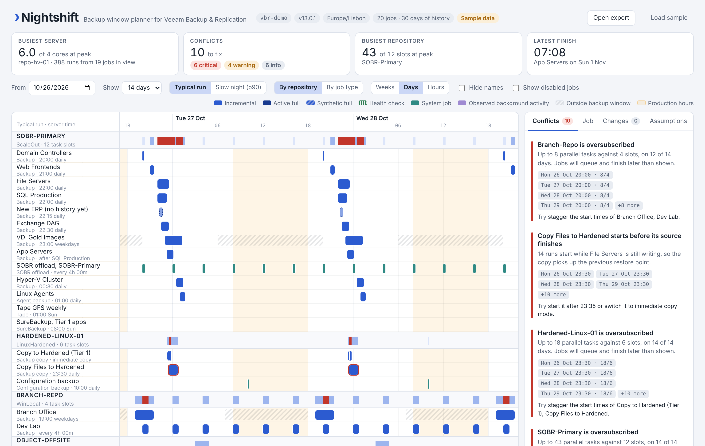

# Nightshift

**A backup window planner for Veeam Backup & Replication.** Nightshift puts every job on one timeline, next to the system jobs and background work that share your proxies, repositories and gateways. It predicts each run's length from your session history, adds up the load on every server, and marks the nights where jobs collide. Drag a job to a new start time and the conflicts update before you change anything in VBR.



> Community project. Veeam Software doesn't make, endorse or support it.

**[Try the live demo](https://falkobanaszak.github.io/nightshift/)** with sample data, nothing to install.

## Why

The VBR console shows a job's schedule inside that job's settings, one job at a time. You never see the whole night. Jobs pile up at 22:00, three fulls land on the same Saturday, a backup copy starts before its source finishes, and you find out when a job is still running at 08:30.

The VeeamHub Health Check shows concurrency from past sessions, and Veeam ONE has a schedule report. Use Nightshift before that, while you plan a change.

## How to use it

You need two files from the [latest release](https://github.com/falkobanaszak/nightshift/releases/latest), the collector script `Collect-NightshiftData.ps1` and the planner `nightshift.html`.

### 1. Export your configuration

1. Copy `Collect-NightshiftData.ps1` to your VBR server.
2. Right-click the file, open **Properties** and tick **Unblock** if Windows shows that option. Windows blocks scripts downloaded from the internet.
3. Open PowerShell with an account that can log in to the VBR console, go to the folder with the script, and run this command.

   ```powershell
   .\Collect-NightshiftData.ps1 -ActivityFromRest -ReadHardware
   ```

   `-ActivityFromRest` adds background work such as retention and maintenance, and asks for your VBR login once. `-ReadHardware` reads CPU and RAM of your Windows servers. Leave both out for a quick first look.
4. The script prints the name of the JSON file it wrote, for example `nightshift-VBR01-20261028-0930.json`. Copy that file to your laptop.

**v13 Linux appliance.** You can't run scripts on the appliance itself. Run the collector from any Windows, Mac or Linux machine with PowerShell 7 instead.

```powershell
.\Collect-NightshiftData.ps1 -Mode Rest -Server vbr01.lab.local -SkipCertificateCheck
```

**Sharing in a forum post.** Add `-Anonymize`. The script replaces every job, repository and server name with a neutral label.

### 2. Load it into the planner

1. Double-click `nightshift.html`. It opens in your browser and runs offline, nothing gets uploaded.
2. Click **Open export** and pick your JSON file, or drag the file onto the page.

The page opens with sample data, so you can explore it before you export anything.

### 3. Read the summary

The four tiles at the top answer four questions.

- **Busiest server.** Which server works hardest, and how many cores it needs at peak. Click the tile to jump to that server.
- **Conflicts.** How many problems Nightshift found, split into critical, warning and info.
- **Busiest repository.** The highest number of parallel tasks against that repository's slot limit.
- **Latest finish.** When the last backup of the night ends.

### 4. Pick the time range

Under **Show**, choose **1 night**, **1 day**, or 3, 7, 14 or 31 days. **1 night** runs from 12:00 to 12:00, so a backup window that crosses midnight stays in one piece. Use the arrows next to the date to step one day back or forward, and **Today** to come back.

Switch from **Typical run** to **Slow night (p90)** to test against the slowest 10% of past runs.

### 5. Work through the conflicts

1. The **Conflicts** tab on the right lists every problem, critical first.
2. Click one. The timeline jumps to the night it happens and highlights the jobs involved.
3. Read the *Try* line under each conflict for a suggested fix.

The blue bar above the timeline tells you what you're looking at. Click **Back to full view** or press **Esc** to clear it.

### 6. Try a fix

- **Drag a bar** sideways to move that job's start time. It snaps to 15 minutes and moves every run of the job.
- **Click a job name** to change its start time, run days, full backup days or target repository.
- **Click a repository name** to try a different task limit.
- **Click a server name** to enter or change its cores and RAM.

The conflicts and tiles recalculate after each change.

### 7. Check the infrastructure

Switch the row filter from **Everything** to **Infrastructure**. You now see three groups.

- **Proxy pools and repositories** with their slot usage over time. Red means more tasks than slots.
- **Servers** with the CPU need of all their Veeam roles together, so a server that is both proxy and repository shows the combined load.
- **Background activity** with the hours retention, maintenance, malware scans and restores usually run, taken from your session history.

### 8. Apply your changes in VBR

1. Open the **Changes** tab. It lists everything you changed.
2. Click **Copy as checklist** and paste it into your ticket or notes.
3. Make the changes in the VBR console. Nightshift never writes to VBR.
4. After a week, run the collector again and load the new export. Check that the conflicts are gone.

## What it flags

| Conflict | Severity | What it means |
|---|---|---|
| Repository or proxy pool oversubscribed | Critical at 1.5x the limit, warning below | Jobs running at the same time want more task slots than the repository or proxies have, so some of them queue |
| Runs past its backup window | Critical | Nightshift predicts the job still runs when its window closes, and VBR can stop it there |
| Backup copy starts before its source finishes | Critical | A periodic copy starts while the source job still writes, so it copies yesterday's restore point |
| Still running when the next run is due | Critical | A periodic or long job overlaps itself |
| Scheduled outside its own window | Warning | The start time falls in hours the window blocks |
| Runs into production hours | Warning (info for periodic and system jobs) | The job still runs during the hours you set as business hours |
| Several fulls on one repository the same night | Warning at 3 or more, info at 2 | Active and synthetic fulls pile onto one night |
| Server short on CPU or RAM | Critical at 1.5x, warning below | The roles on one server (proxy, repository, extent, gateway) need more cores or RAM than it has |
| Busy hours overlap with background activity | Warning or info | Retention, maintenance, malware scans or restores usually run while a repository or server sits near its limit |
| Server hardware unknown | Info | Nightshift shows the peak need. Enter the server's cores and RAM to check it |
| No run history | Info | Nightshift estimates durations from source size and throughput |

## Infrastructure and background work

Backup jobs share your infrastructure with three other kinds of load, and Nightshift shows all three.

**Servers.** Every server behind a proxy, repository, SOBR extent, gateway or mount server gets its own row. Its load adds up what its roles do at that moment. CPU and RAM follow the Veeam best practice guide, 1 core and 2 GB per proxy task, and 1 repository core per 3 tasks with 4 GB per repository core. Gateways count as repository tasks. You can change all four numbers under **Assumptions**. Nightshift leaves out tasks that wait in a queue, because a waiting task uses no CPU.

**System jobs.** The configuration backup, SOBR offload to the capacity tier (every 4 hours by default), SureBackup and tape jobs take slots on their repository like any other job. Nightshift draws them in teal.

**Background activity.** VBR starts retention, repository maintenance, malware detection, Security & Compliance Analyzer runs, restores and rescans on its own, with no schedule to read. The collector reads them from the session history and the planner shows them as an hour-of-week pattern. You'll see that maintenance lands on Saturday night before you schedule six fulls there. This needs the REST API, so use `-Mode Rest`, or `-ActivityFromRest` in the default mode.

## How the prediction works

- **Durations** come from the session history in the export. *Typical run* uses the median, *Slow night* the 90th percentile. Nightshift measures fulls and incrementals separately where VBR records which was which.
- **Synthetic fulls** add a transform step at 35% of a full by default, health checks 25%. Lower both under **Assumptions** for fast-clone repositories on XFS or ReFS.
- **Chained jobs** start when the job before them ends. Immediate backup copies start when each source run ends.
- **Task slots.** Nightshift assumes one slot per machine, up to the repository limit. You can set a different value per job.
- **No history yet?** Nightshift estimates a full from source size at 250 MB/s and an incremental at 15% of that, and draws those runs with a dashed outline.

Nightshift doesn't model storage latency control, network throttling or retries. Treat a clean plan as likely, with no guarantee.

## Collector reference

| Parameter | Default | Notes |
|---|---|---|
| `-Mode` | `PowerShell` | `PowerShell` uses the Veeam cmdlets, `Rest` uses the REST API on port 9419 |
| `-Server` | local | Required for `Rest` |
| `-Credential` | current user | `Rest` asks for it if you leave it out |
| `-HistoryDays` | `30` | How much session history to read |
| `-OutFile` | `.\nightshift-<server>-<date>.json` | |
| `-Anonymize` | off | Replaces names with labels and hashes ids for forum posts |
| `-ApiVersion` | `1.1-rev0` | REST header. Raise it if your server rejects the default |
| `-SkipCertificateCheck` | off | REST only, needs PowerShell 7 |
| `-InvertWindow` | off | Flips how the script reads backup window hours, see known gaps |
| `-ActivityFromRest` | off | Default mode only. Also reads background sessions from the REST API |
| `-ReadHardware` | off | Reads cores and RAM of Windows servers through CIM |

The collector only reads. On large servers the session history takes longest, so lower `-HistoryDays` if a run drags.

## Privacy

The export holds job, repository, proxy and server names, schedules, run times and, with `-ReadHardware`, core and RAM counts. It holds no credentials, VM names or IP addresses. The planner reads the export in your browser and sends nothing anywhere. With `-Anonymize`, or **Hide names** in the planner, you can share a timeline and keep your naming scheme private.

## Status and known gaps

This is version 0.1. I've tested the collector against fake Veeam objects and a mocked REST API (see `tests/`), and not yet against many live servers. Reports from real environments help most right now. Watch these spots.

- **Backup window flags.** The PowerShell object model and the REST API store allowed hours in opposite ways. If the hatched "outside backup window" areas sit exactly where your jobs may run, collect again with `-InvertWindow` and open an issue.
- **Periodic schedules.** Check that a job set to every 4 hours shows 240 minutes.
- **Agent policies, file share jobs and tape** come through as far as the cmdlets expose their schedules. Policy-managed agent jobs may show as not scheduled.
- **REST history** doesn't say which runs were fulls, so the collector treats unusually long runs as fulls.
- **Gateway servers.** When VBR picks gateways on its own, the export may leave them out, and Nightshift puts the load on the repository's server. The collector doesn't read Linux hardware, so enter it in the planner.
- **Background activity** names vary between VBR versions, so some sessions may land under a generic label.

## Roadmap

- A *suggest a start time* button that finds the quietest slot for a job
- Extra collector checks, such as the VBR server acting as a proxy
- A per-night report to attach to a change request

## Repository layout

```
collector/Collect-NightshiftData.ps1   the export script
dist/nightshift.html                   the planner, ready to open
docs/index.html                        the same planner, served by GitHub Pages as the live demo
viewer/src/app.html                    planner source
viewer/build.py                        builds dist/ and docs/ and embeds the sample
sample/                                sample export and its generator
docs/schema.md                         export format
tests/                                 collector tests (pwsh) and planner tests (Playwright)
```

## Contributing

Issues and pull requests are welcome. If a schedule looks wrong, attach an anonymized export (`-Anonymize`) and describe what VBR shows for that job. Run `pwsh tests/Test-Collector.ps1` before you open a pull request that touches the collector. To change the planner, edit `viewer/src/app.html` and run `python3 viewer/build.py`, which rewrites `dist/nightshift.html` and `docs/index.html`. Commit all three. The tests fail when they don't match.

## License

MIT. See [LICENSE](LICENSE). Veeam and Veeam Backup & Replication are trademarks of Veeam Software. This project uses the names to describe what it works with.
